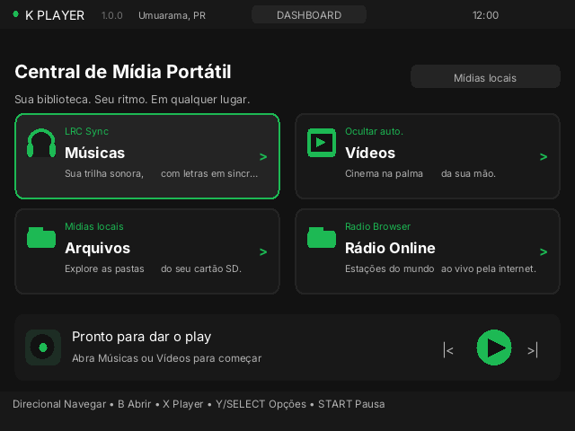
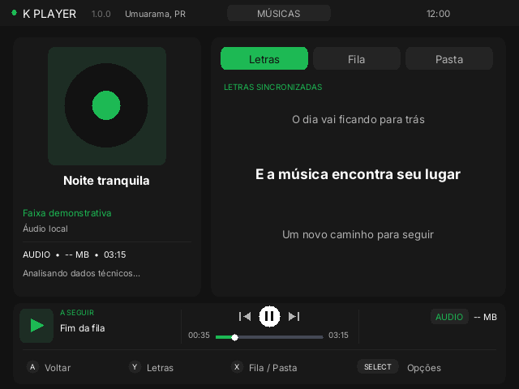
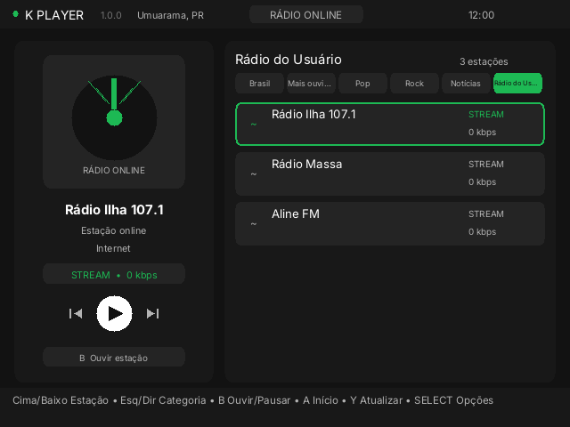
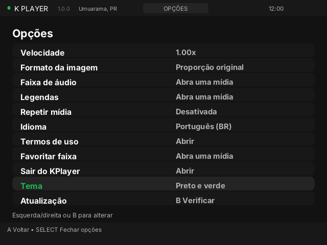
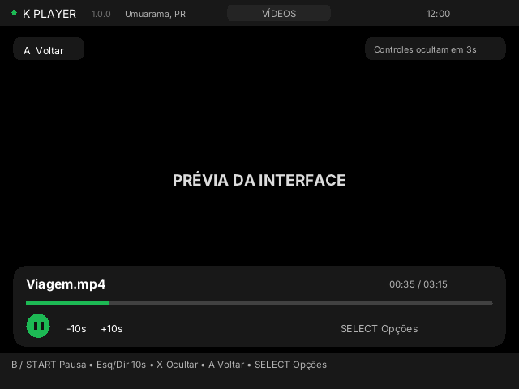
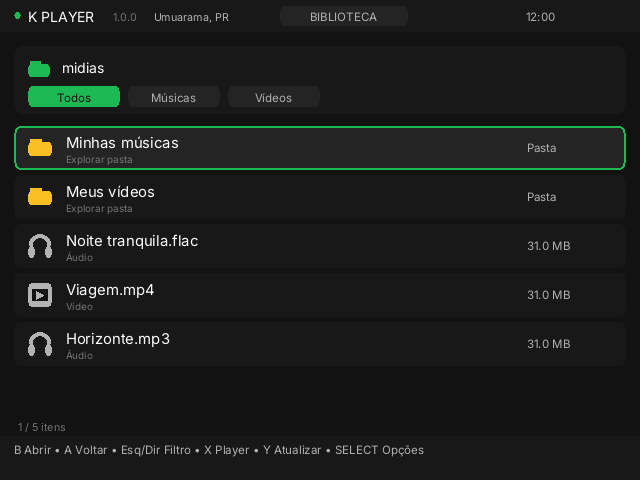

# KPlayer 1.0.0

Music, video and internet radio for handheld devices, designed for **R36S with dArkOS and PortMaster**. Built in C with SDL2 and libVLC, with a 640 × 480 interface for physical controls.

[Português brasileiro](README.pt-BR.md) · [Installation](docs/INSTALL.md) · [Controls](docs/CONTROLS.md) · [Media and lyrics](docs/MEDIA.md) · [Licenses and credits](THIRD_PARTY.md) · [Publishing guide](PUBLICACAO-1.0.0.md)

> **Project status:** 1.0.0 release candidate with an experimental updater. The previous radio fix was reported working on a device, but this package, its themes, loading indicator and updater still need physical testing. Android code is experimental and is not part of the R36S release.

## Screenshots

These are actual application screens rendered on a computer with demo data, not photos of the console. Radio availability and content may change.

| Dashboard | Music |
| :---: | :---: |
|  |  |
| **Online radio** | **Settings and themes** |
|  |  |
| **Video** | **Library** |
|  |  |

## Features

- Local music and video via libVLC; decoding depends on the target system's codecs and plugins.
- Media scan in `kplayer/midias`, `/roms` and `/roms2`, manual browsing and a loading indicator.
- Metadata, artwork, queue, next track and supported local LRC or embedded lyrics. Lyrics are not downloaded.
- Radio Browser directory and a User Radio section for personal playlists.
- Seven themes; Brazilian Portuguese, English and Spanish; first-run welcome and usage notices.
- Video playback options and available audio/subtitle tracks.
- Experimental GitHub release check at startup, with consent before installation.

## Requirements and installation

An ARM64 R36S with compatible dArkOS and configured PortMaster is the intended target; other devices and firmware are not guaranteed. The system must supply compatible SDL2, audio output and VLC plugins. Radio and updates need internet; the updater needs `python3` with HTTPS. Radio logos may require `curl` and JPEG/PNG support.

1. Download the installable R36S ZIP from [Releases](https://github.com/kaiaum01/KPLAYER-v1.0.0/releases), if published. The source ZIP is not an installer.
2. Extract it and copy `KPlayer.sh` and `kplayer/` side by side to the SD card's `ports/` directory. Preserve personal media, radio lists and settings when replacing an installation.
3. Refresh the ports list if needed and start **KPlayer**. Select the language on first run; usage notices are available on the welcome screen.

Older installations need a manual installation of the new executable, `updater.py` and `KPlayer.sh` before automatic updates can work. Once the new launcher works, remove only the old `KPlayer (Beta).sh` to avoid a duplicate menu entry; keep the `kplayer/` directory. More details: [installation](docs/INSTALL.md).

## Controls

| Button | Main action |
| --- | --- |
| D-pad | Navigate / change options |
| B / A | Confirm / back |
| SELECT | Open or close settings |
| START | Pause / resume media |
| X / Y | Context-dependent actions shown on screen |
| L1 / R1 | Previous / next track or station where available |

Use the console's physical/system controls for volume. See the [full control map](docs/CONTROLS.md).

## Media and user radio

Put files in `ports/kplayer/midias/` or use the browser. The automatic scan ignores files below 50 KiB and is limited to 4,096 results; the manual browser may show smaller files. Access to `/roms` and `/roms2` depends on the firmware and permissions.

Recognized extensions include MP3, FLAC, OGG, WAV, M4A, AAC and OPUS for audio, and MP4, MKV, AVI, MOV and WEBM for video. **Extension recognition does not guarantee decoding or performance**: codec, profile and resolution depend on installed plugins and the device. See [media details](docs/MEDIA.md).

Place `.pls`, `.asx`, `.m3u` or `.m3u8` files in `ports/kplayer/radios_usuario/`. Open **Online Radio**, use left/right to select **User Radio**, then press **Y** to refresh. Files are limited to 64 KiB, HTTP/HTTPS URLs are recognized and not all playlist variants work. Included stations are examples and may go offline.

## Experimental updater

At startup the app checks the latest public release. If a newer compatible package is found, it asks before installing. Selecting **No**, no update being available or a failed check allows normal startup. Selecting **Yes** installs and restarts; press B to continue after installation failure. The launcher and updater script themselves are not updated automatically.

The release must include a compatible ZIP and checksum. SHA-256 checks integrity, **not a digital signature**. Power loss during replacement has no automatic recovery. Test on a copied SD card first; see [limitations](ATUALIZADOR-EXPERIMENTAL.md) and the [publishing guide](PUBLICACAO-1.0.0.md).

## Privacy and troubleshooting

Radio directories, streams and the approximate-location lookup contact third-party services. The location service uses the public IP and may use HTTP; radio streams can use HTTP or HTTPS. Provider availability, privacy and terms vary.

If the app does not start, check PortMaster, system plugins and `ports/kplayer/log.txt`. If media is missing, check paths, extensions, the size limit and the manual browser. For a radio failure, try another station and check connectivity. An update requires a newer public compatible release, Python 3 and internet; drafts and prereleases are not used. The synchronous scanning indicator may pause while the card is busy. Remove personal data from logs before sharing them.

Back up `midias/`, `radios_usuario/`, `settings.cfg`, `preferences.cfg` and `favorites.cfg` before changes.

## Development and licenses

See [build instructions](docs/BUILD.md), [contributing](CONTRIBUTING.md), [changelog](CHANGELOG.md) and [publishing](PUBLICACAO-1.0.0.md). Original interface code is **GPL-2.0-or-later**; see [LICENSE](LICENSE). VLC/libVLC, SDL, stb and fonts have their own terms: [THIRD_PARTY.md](THIRD_PARTY.md) and `ports/kplayer/licencas/`. VLC source and patch are under `upstream/` and `patches/`.

KPlayer is not officially affiliated with or endorsed by VideoLAN or PortMaster.
