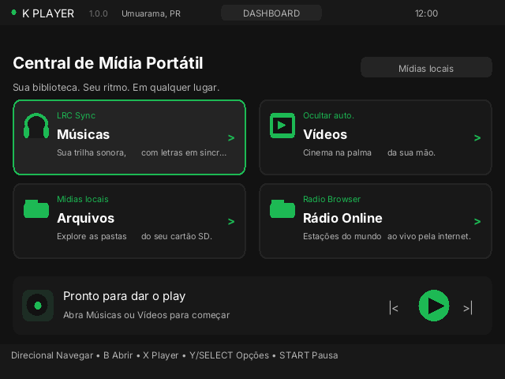
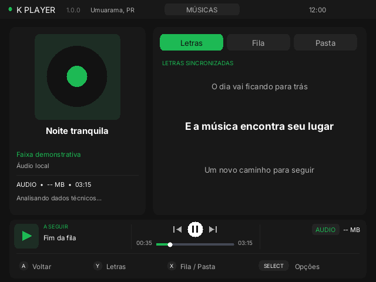
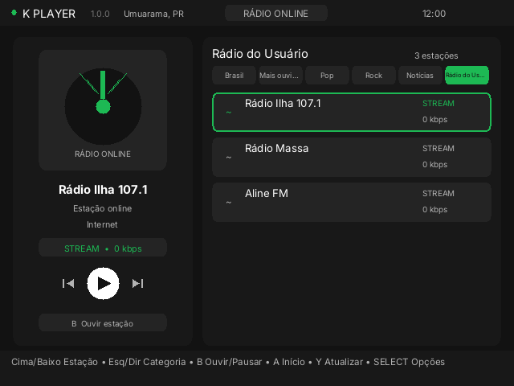
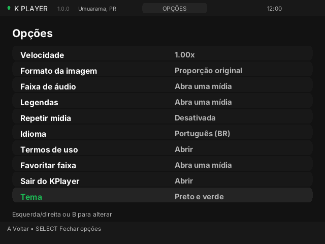

# KPlayer 1.0.0

Music, video and internet radio for the R36S, built with C, SDL2 and libVLC.
Designed for 640 × 480 physical controls on dArkOS / PortMaster.

[Português](README.pt-BR.md) · [Installation](docs/INSTALL.md) · [Licenses](THIRD_PARTY.md)

> **Release candidate:** the radio fix was reported working on R36S, but the new
> themes, loading indicator and v1.0.0 ARM64 build require device testing.
> Automatic updates are **not implemented**. Android code is experimental
> and not included in the R36S release.

## Screenshots

Actual 640 × 480 UI renders with demo data on a computer, not device photos.

| Dashboard | Music |
| --- | --- |
|  |  |
| **User radio** | **Settings and themes** |
|  |  |

## Features

- Local music and video with libVLC; formats depend on system codecs/plugins.
- Automatic media discovery in `midias`, `/roms` and `/roms2`, and manual browsing.
- Music metadata, JPEG/PNG artwork, supported embedded lyrics and LRC, queue and next track.
- Radio Browser and user PLS, ASX, M3U and M3U8 radio playlists.
- Seven themes, Portuguese/English/Spanish, first-run welcome and usage notices.
- Indeterminate loading indicator during file scanning.

## Installation

Run **Compilar KPlayer R36S** in GitHub Actions, download the artifact and
extract `KPlayer-v1.0.0-R36S.zip`. Copy `KPlayer (Beta).sh` and `kplayer/`
side by side to the SD card's `ports/` folder. The launcher retains its old
name for compatibility. See [installation](docs/INSTALL.md).
The source ZIP is not an installable release.

Controls: B confirm, A back, SELECT options, START pause and D-pad navigation;
volume uses the console's controls. [Controls](docs/CONTROLS.md).

## Known limitations

Automatic scanning ignores files below 50 KiB and stops at 4,096 entries.
Scanning is synchronous and the animation may pause if storage blocks.
Some radio links and playlist variants can fail. Station logos require optional
`curl` and JPEG/PNG. Network operations and external services can fail;
see [third-party notices](THIRD_PARTY.md). A libVLC network operation may
remain blocked even when a different station has been selected.

Back up `midias/`, `radios_usuario/`, `settings.cfg`, `preferences.cfg`
and `favorites.cfg` before updating. Report errors with
`ports/kplayer/log.txt`, after removing personal information.

Original interface code is GPL-2.0-or-later; dependencies have their own
licenses. See [LICENSE](LICENSE) and [THIRD_PARTY.md](THIRD_PARTY.md).
Not affiliated with VideoLAN or PortMaster.
